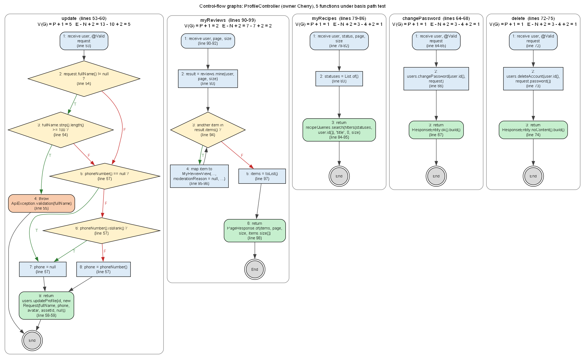

# ProfileController - STQA report (Cherry)

Source under test: [`backend/src/main/java/com/bachelorchef/controller/ProfileController.java`](../../../backend/src/main/java/com/bachelorchef/controller/ProfileController.java)  
Test code: [`backend/src/test/java/com/bachelorchef/stqa/cherry`](../../../backend/src/test/java/com/bachelorchef/stqa/cherry)  
Executed: (not run) with JUnit 5 + Mockito + MockMvc (standalone controller, real validation and error handler, mocked services).

## Execution summary

| Technique | Cases | Pass | Fail | Not run |
|---|---|---|---|---|
| BVA | 10 | 7 | 3 | 0 |
| ECT | 10 | 6 | 4 | 0 |
| Basis path | 10 | 5 | 5 | 0 |
| Total | 30 | 18 | 12 | 0 |

Every failing case confirms a seeded defect (see the Defect column); no test failed for any other reason.

## Test cases

| TC ID | Action/Feature | Test Data | Expected Result | Actual Result | Status | xUnit Method |
|---|---|---|---|---|---|---|
| TC-01 | Change password: new length (BVA) | newPassword = 7 chars | 400 fieldErrors.newPassword; not changed | As expected. JUnit: Passed (59 ms). | Pass | ProfileBvaTest.newPasswordLength(TC-01, 7, false) |
| TC-02 | Change password: new length (BVA) | newPassword = 8 chars (min) | Accepted (2xx); password changed | As expected. JUnit: Passed (38 ms). | Pass | ProfileBvaTest.newPasswordLength(TC-02, 8, true) |
| TC-03 | Change password: new length (BVA) | newPassword = 72 chars (max) | Accepted (2xx); password changed | As expected. JUnit: Passed (37 ms). | Pass | ProfileBvaTest.newPasswordLength(TC-03, 72, true) |
| TC-04 | Change password: new length (BVA) | newPassword = 73 chars | 400 fieldErrors.newPassword; not changed | As expected. JUnit: Passed (45 ms). | Pass | ProfileBvaTest.newPasswordLength(TC-04, 73, false) |
| TC-05 | Update profile: phone length (BVA) | phoneNumber = 20 digits (max) | 200; phone sent to the service unchanged | As expected. JUnit: Passed (721 ms). | Pass | ProfileBvaTest.phoneLength(TC-05, 20, true) |
| TC-06 | Update profile: phone length (BVA) | phoneNumber = 21 digits | 400 fieldErrors.phoneNumber | As expected. JUnit: Passed (336 ms). | Pass | ProfileBvaTest.phoneLength(TC-06, 21, false) |
| TC-07 | Update profile: full name length (BVA) | fullName = 99 chars | 200; name sent to the service | As expected. JUnit: Passed (44 ms). | Pass | ProfileBvaTest.fullNameLength(TC-07, 99) |
| TC-08 | Update profile: full name length (BVA) | fullName = 100 chars (max) | 200; name sent to the service | Defect BUG-13: Status expected:<200> but was:<400>. JUnit: Failed (46 ms). | Fail | ProfileBvaTest.fullNameLength(TC-08, 100) |
| TC-09 | My submissions: second page (BVA) | page = 1, size = 12 | Search asked for page 1 | Defect BUG-18: service was called with recipeQueryService.search( Filters[query=null, ingredientId=null, tagId=null, difficulty=null, source=null, maxCostBdt=null, maxTotalTimeMins=null, statuses=[], authorId=5], "title", 0, 12 );. JUnit: Failed (51 ms). | Fail | ProfileBvaTest.secondPageOfSubmissions |
| TC-10 | My reviews: totals across pages (BVA) | 3 reviews, size = 2 | 2 items, totalElements 3, totalPages 2 | Defect BUG-19: JSON path "$.totalElements" expected:<3> but was:<2>. JUnit: Failed (69 ms). | Fail | ProfileBvaTest.reviewTotalsAcrossPages |
| TC-11 | Update profile: bio (ECT) | bio = 'Student cook from Dhaka' | Bio sent to the service | Defect BUG-11: service was called with userService.updateProfile( 5L, UpdateProfileRequest[fullName=null, phoneNumber=null, avatarUrl=null, avatarAssetId=null, bio=null] );. JUnit: Failed (40 ms). | Fail | ProfileEctTest.bioSaved |
| TC-12 | Update profile: clear phone (ECT) | phoneNumber = "" | "" sent so the phone is removed | Defect BUG-12: service was called with userService.updateProfile( 5L, UpdateProfileRequest[fullName=null, phoneNumber=null, avatarUrl=null, avatarAssetId=null, bio=null] );. JUnit: Failed (65 ms). | Fail | ProfileEctTest.clearPhone |
| TC-13 | Update profile: valid phone (ECT) | phoneNumber = +8801712345678 | Phone sent unchanged | As expected. JUnit: Passed (45 ms). | Pass | ProfileEctTest.validPhone |
| TC-14 | My submissions: status filter (ECT) | status = APPROVED | Search asked for [APPROVED] of my recipes | Defect BUG-16: service was called with recipeQueryService.search( Filters[query=null, ingredientId=null, tagId=null, difficulty=null, source=null, maxCostBdt=null, maxTotalTimeMins=null, statuses=[], authorId=5], "title", 0, null );. JUnit: Failed (31 ms). | Fail | ProfileEctTest.statusFilterApplied |
| TC-15 | My submissions: no filter (ECT) | (no status) | Search asked for all statuses of my recipes | As expected. JUnit: Passed (27 ms). | Pass | ProfileEctTest.noStatusFilter |
| TC-16 | My submissions: unknown status (ECT) | status = PUBLISHED | 400; search not called | As expected. JUnit: Passed (58 ms). | Pass | ProfileEctTest.unknownStatus |
| TC-17 | Change password: wrong current (ECT) | currentPassword = wrong-one | 400 fieldErrors.currentPassword | As expected. JUnit: Passed (39 ms). | Pass | ProfileEctTest.wrongCurrentPassword |
| TC-18 | Delete account: last admin (ECT) | service reports LAST_ADMIN | 409, code LAST_ADMIN | As expected. JUnit: Passed (42 ms). | Pass | ProfileEctTest.lastAdminCannotDelete |
| TC-19 | Delete account: blank password (ECT) | password = '  ' | 400 'Password is required.'; nothing deleted | As expected. JUnit: Passed (47 ms). | Pass | ProfileEctTest.blankDeletePassword |
| TC-20 | My reviews: rejected review (ECT) | REJECTED, reason 'Off topic' | Status REJECTED with reason 'Off topic' | Defect BUG-20: JSON path "$.items[0].moderationReason" expected:<Off topic> but was:<null>. JUnit: Failed (41 ms). | Fail | ProfileEctTest.rejectedReviewShowsReason |
| TC-21 | update P1 (basis path) | fullName = null, phone = null | Service gets fullName null, phone null | As expected. JUnit: Passed (37 ms). | Pass | ProfileBasisPathTest.updateP1 |
| TC-22 | update P2 (basis path) | fullName = 120 chars | ApiException 400; nothing saved | As expected. JUnit: Passed (35 ms). | Pass | ProfileBasisPathTest.updateP2 |
| TC-23 | update P3 (basis path) | fullName = 'Cherry', phone = null | Service gets 'Cherry' and phone null | As expected. JUnit: Passed (31 ms). | Pass | ProfileBasisPathTest.updateP3 |
| TC-24 | update P4 (basis path) | phone = "" | Service gets phone "" (clear) | Defect BUG-12: expected: <> but was: <null>. JUnit: Failed (27 ms). | Fail | ProfileBasisPathTest.updateP4 |
| TC-25 | update P5 (basis path) | phone = +8801712345678 | Service gets the phone unchanged | As expected. JUnit: Passed (27 ms). | Pass | ProfileBasisPathTest.updateP5 |
| TC-26 | myReviews P1 (basis path) | no reviews | Empty items, totalElements 0 | As expected. JUnit: Passed (34 ms). | Pass | ProfileBasisPathTest.myReviewsP1 |
| TC-27 | myReviews P2 (basis path) | 1 REJECTED review with reason | Same review returned, reason kept | Defect BUG-20: expected: <[MyReviewView[id=1, recipeId=21, recipeTitle=Egg Fried Rice, rating=4, comment=Nice and quick, photoUrl=null, status=REJECTED, moderationReason=Off topic, updatedAt=2026-10-10T08:00:00Z]]> but was: <[MyReviewView[id=1, .... JUnit: Failed (47 ms). | Fail | ProfileBasisPathTest.myReviewsP2 |
| TC-28 | myRecipes P1 (basis path) | page = 2, size = 12 | Search: my recipes, sort 'newest', page 2 | Defect BUG-17, BUG-18: Argument(s) are different! Wanted: recipeQueryService.search( <custom argument matcher>, "newest", 2, 12 ); -> at com.bachelorchef.service.RecipeQueryService.search(RecipeQueryService.java:69) Actual invocations have different arg.... JUnit: Failed (5721 ms). | Fail | ProfileBasisPathTest.myRecipesP1 |
| TC-29 | changePassword P1 (basis path) | valid request | Password changed; 204 No Content | Defect BUG-14: expected: <204 NO_CONTENT> but was: <200 OK>. JUnit: Failed (34 ms). | Fail | ProfileBasisPathTest.changePasswordP1 |
| TC-30 | delete P1 (basis path) | password = 123456 | Deleted; 204 and Set-Cookie clears bc_refresh | Defect BUG-15: Set-Cookie header missing expected: not <null>. JUnit: Failed (83 ms). | Fail | ProfileBasisPathTest.deleteP1 |

## Boundary value analysis

| Input | Function | Constraint | Min-1 | Min | Min+1 | Nominal | Max-1 | Max | Max+1 | Expected | Cases |
|---|---|---|---|---|---|---|---|---|---|---|---|
| New password length | changePassword (POST /users/me/password) | 8..72 chars (ChangePasswordRequest @Size) | 7 | 8 | 9 | 12 | 71 | 72 | 73 | 7 and 73 rejected (400); 8..72 accepted | TC-01..04 |
| Phone number length | update (PATCH /users/me) | <= 20 chars (UpdateProfileRequest @Size(max = 20)) | - | 0 | 1 | 14 | 19 | 20 | 21 | 21 rejected (400); up to 20 sent to the service | TC-05, TC-06 |
| Full name length | update (PATCH /users/me) | 2..100 chars (users.full_name VARCHAR(100)) | 1 | 2 | 3 | 20 | 99 | 100 | 101 | Up to 100 accepted; longer rejected | TC-07, TC-08, TC-22 |
| My submissions page index | myRecipes (GET /users/me/recipes) | page >= 0 | -1 | 0 | 1 | 2 | - | - | - | Requested page passed unchanged | TC-09, TC-28 |
| Reviews total vs page size | myReviews (GET /users/me/reviews) | totalElements counts all pages | - | total = 0 | total = 1 | - | total = size | - | total = size + 1 | totalElements = all reviews; totalPages = ceil(total / size) | TC-10, TC-26 |

## Equivalence classes

| Input | Class | Description | Valid/invalid | Representative | Expected | Cases |
|---|---|---|---|---|---|---|
| Bio | EC1 | Non-empty text | Valid | Student cook from Dhaka | Sent to the service and saved | TC-11 |
| Phone | EC2 | Empty string (clear) | Valid | "" | Sent as "" so the number is removed | TC-12, TC-24 |
| Phone | EC3 | Valid number | Valid | +8801712345678 | Sent unchanged | TC-13, TC-25 |
| Phone | EC4 | Too long | Invalid | 21 digits | 400 | TC-06 |
| Submission status filter | EC5 | Known status | Valid | APPROVED | Only that status listed | TC-14 |
| Submission status filter | EC6 | No status | Valid | (none) | All statuses listed | TC-15 |
| Submission status filter | EC7 | Unknown status | Invalid | PUBLISHED | 400; search not called | TC-16 |
| Current password | EC8 | Wrong password | Invalid | wrong-one | 400 fieldErrors.currentPassword | TC-17 |
| Delete account | EC9 | Last active admin | Invalid | only admin left | 409 LAST_ADMIN | TC-18 |
| Delete account | EC10 | Blank password | Invalid | '  ' | 400 'Password is required.' | TC-19 |
| My review state | EC11 | Rejected with reason | Valid | REJECTED + 'Off topic' | Reason shown to the author | TC-20, TC-27 |

## Basis path testing

V(G) is computed from the control-flow graph of the current source: decisions + 1, cross-checked with E - N + 2.

| Function | Lines | Decisions | V(G)=P+1 | E | N | E-N+2 | Paths | Pass | Fail |
|---|---|---|---|---|---|---|---|---|---|
| update | 53-60 | 4 | 5 | 13 | 10 | 5 | 5 | 4 | 1 |
| myReviews | 90-99 | 1 | 2 | 7 | 7 | 2 | 2 | 1 | 1 |
| myRecipes | 79-86 | 0 | 1 | 3 | 4 | 1 | 1 | 0 | 1 |
| changePassword | 64-68 | 0 | 1 | 3 | 4 | 1 | 1 | 0 | 1 |
| delete | 72-75 | 0 | 1 | 3 | 4 | 1 | 1 | 0 | 1 |

| Function | Path | Node sequence | Conditions | Test case | Result |
|---|---|---|---|---|---|
| update | P1 | 1 -> 2 -> 5 -> 7 -> 9 -> End | fullName: F; phone null: T | TC-21 | Pass |
| update | P2 | 1 -> 2 -> 3 -> 4 -> End | fullName: T; length >= 100: T | TC-22 | Pass |
| update | P3 | 1 -> 2 -> 3 -> 5 -> 7 -> 9 -> End | fullName: T; length: F; phone null: T | TC-23 | Pass |
| update | P4 | 1 -> 2 -> 5 -> 6 -> 7 -> 9 -> End | fullName: F; phone null: F; blank: T | TC-24 | Fail |
| update | P5 | 1 -> 2 -> 5 -> 6 -> 8 -> 9 -> End | fullName: F; phone null: F; blank: F | TC-25 | Pass |
| myReviews | P1 | 1 -> 2 -> 3 -> 5 -> 6 -> End | loop: 0 times | TC-26 | Pass |
| myReviews | P2 | 1 -> 2 -> 3 -> 4 -> 3 -> 5 -> 6 -> End | loop: 1+ times | TC-27 | Fail |
| myRecipes | P1 | 1 -> 2 -> 3 -> End | (no decision) | TC-28 | Fail |
| changePassword | P1 | 1 -> 2 -> 3 -> End | (no decision) | TC-29 | Fail |
| delete | P1 | 1 -> 2 -> 3 -> End | (no decision) | TC-30 | Fail |

## Defects confirmed

| Defect | Title | Severity | Confirmed by |
|---|---|---|---|
| BUG-11 | Bio changes are not saved | Minor | TC-11 |
| BUG-12 | Phone number cannot be cleared | Minor | TC-12, TC-24 |
| BUG-13 | Full name of exactly 100 characters is rejected | Minor | TC-08 |
| BUG-14 | Change password returns 200 OK instead of 204 No Content | Low | TC-29 |
| BUG-15 | Deleting the account does not clear the refresh cookie | Low | TC-30 |
| BUG-16 | "My submissions" status filter is ignored | Minor | TC-14 |
| BUG-17 | "My submissions" are sorted by title instead of newest first | Minor | TC-28 |
| BUG-18 | "My submissions" paging always returns the first page | Minor | TC-09, TC-28 |
| BUG-19 | "My reviews" totals only count the current page | Minor | TC-10 |
| BUG-20 | Moderator's rejection reason is not shown to the author | Minor | TC-20, TC-27 |

## Files

- `Profile_TestCases.xlsx` - the 30 test cases in the team format (TC ID ... xUnit Method)
- `Profile_TestDesign.xlsx` - summary, BVA table, ECT table, full test-case sheet, defects
- `Profile_BasisPath.xlsx` + `Profile_FlowGraphs.png` - V(G), independent paths, node legend, flow graphs
- `evidence/` - JUnit XML of the run these files were generated from
