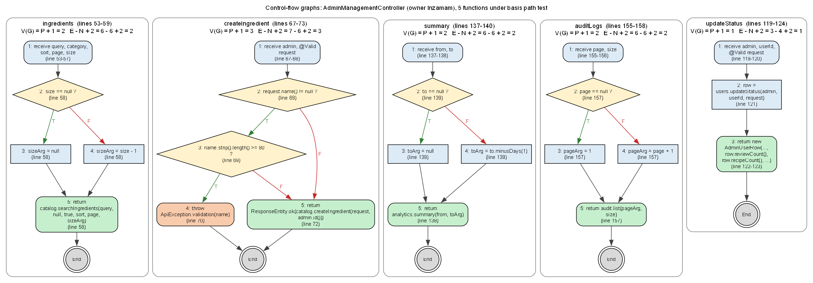

# AdminManagementController - STQA report (Inzamam)

Source under test: [`backend/src/main/java/com/bachelorchef/controller/AdminManagementController.java`](../../../backend/src/main/java/com/bachelorchef/controller/AdminManagementController.java)  
Test code: [`backend/src/test/java/com/bachelorchef/stqa/inzamam`](../../../backend/src/test/java/com/bachelorchef/stqa/inzamam)  
Executed: (not run) with JUnit 5 + Mockito + MockMvc (standalone controller, real validation and error handler, mocked services).

## Execution summary

| Technique | Cases | Pass | Fail | Not run |
|---|---|---|---|---|
| BVA | 10 | 5 | 5 | 0 |
| ECT | 10 | 4 | 6 | 0 |
| Basis path | 10 | 4 | 6 | 0 |
| Total | 30 | 13 | 17 | 0 |

Every failing case confirms a seeded defect (see the Defect column); no test failed for any other reason.

## Test cases

| TC ID | Action/Feature | Test Data | Expected Result | Actual Result | Status | xUnit Method |
|---|---|---|---|---|---|---|
| TC-01 | Create ingredient: name length (BVA) | name = '' (0 chars) | 400, fieldErrors.name; nothing saved | As expected. JUnit: Passed (45 ms). | Pass | AdminManagementBvaTest.ingredientNameLength(TC-01, 0, false) |
| TC-02 | Create ingredient: name length (BVA) | name = 1 char | Accepted (2xx); catalogue.createIngredient called | As expected. JUnit: Passed (35 ms). | Pass | AdminManagementBvaTest.ingredientNameLength(TC-02, 1, true) |
| TC-03 | Create ingredient: name length (BVA) | name = 79 chars | Accepted (2xx) | As expected. JUnit: Passed (48 ms). | Pass | AdminManagementBvaTest.ingredientNameLength(TC-03, 79, true) |
| TC-04 | Create ingredient: name length (BVA) | name = 80 chars (max) | Accepted (2xx): 80 is the maximum allowed | Defect BUG-05: Range for response status value 400 expected:<SUCCESSFUL> but was:<CLIENT_ERROR>. JUnit: Failed (48 ms). | Fail | AdminManagementBvaTest.ingredientNameLength(TC-04, 80, true) |
| TC-05 | Create ingredient: name length (BVA) | name = 81 chars | 400, fieldErrors.name; nothing saved | As expected. JUnit: Passed (37 ms). | Pass | AdminManagementBvaTest.ingredientNameLength(TC-05, 81, false) |
| TC-06 | Ingredient list: page size (BVA) | size = 1 (min) | Catalogue asked for size 1 | Defect BUG-02: service was called with catalogService.searchIngredients( null, null, true, null, null, 0 );. JUnit: Failed (32 ms). | Fail | AdminManagementBvaTest.ingredientPageSize(TC-06, 1) |
| TC-07 | Ingredient list: page size (BVA) | size = 100 (max) | Catalogue asked for size 100 | Defect BUG-02: service was called with catalogService.searchIngredients( null, null, true, null, null, 99 );. JUnit: Failed (29 ms). | Fail | AdminManagementBvaTest.ingredientPageSize(TC-07, 100) |
| TC-08 | Audit log: first page (BVA) | page = 0, size = 20 | Audit service asked for page 0 | Defect BUG-10: service was called with auditService.list(1, 20);. JUnit: Failed (32 ms). | Fail | AdminManagementBvaTest.auditFirstPage |
| TC-09 | Dashboard: one-day range (BVA) | from = to = 2026-10-13 | Analytics asked for 2026-10-13..2026-10-13 (inclusive) | Defect BUG-09: service was called with analyticsService.summary( 2026-10-13, 2026-10-12 );. JUnit: Failed (32 ms). | Fail | AdminManagementBvaTest.dashboardOneDayRange |
| TC-10 | Create tag: name length (BVA) | name = 41 chars | 400 'Must be at most 40 characters.'; nothing saved | As expected. JUnit: Passed (41 ms). | Pass | AdminManagementBvaTest.tagNameTooLong |
| TC-11 | Ingredient list: category given (ECT) | category = Spices | Catalogue asked for category 'Spices' | Defect BUG-01: service was called with catalogService.searchIngredients( null, null, true, null, null, null );. JUnit: Failed (27 ms). | Fail | AdminManagementEctTest.categoryGiven |
| TC-12 | Ingredient list: category absent (ECT) | (no category) | Catalogue asked with no category filter | As expected. JUnit: Passed (40 ms). | Pass | AdminManagementEctTest.categoryAbsent |
| TC-13 | User list: role filter (ECT) | role = ADMIN | User search asked for role ADMIN | Defect BUG-07: service was called with adminUserService.search( null, null, null, null, null, null );. JUnit: Failed (37 ms). | Fail | AdminManagementEctTest.roleFilter |
| TC-14 | User list: status filter (ECT) | status = SUSPENDED | User search asked for status SUSPENDED | As expected. JUnit: Passed (34 ms). | Pass | AdminManagementEctTest.statusFilter |
| TC-15 | Create ingredient: valid request (ECT) | name = Garlic, Spices, g | 201 Created, body name 'Garlic' | Defect BUG-04: Status expected:<201> but was:<200>. JUnit: Failed (46 ms). | Fail | AdminManagementEctTest.createIngredientStatus |
| TC-16 | Create tag: padded name (ECT) | name = '   Spicy Food   '; saved as 'Spicy Food' | 201, response name 'Spicy Food' (same as saved) | Defect BUG-06: JSON path "$.name" expected:<Spicy Food> but was:< Spicy Food >. JUnit: Failed (44 ms). | Fail | AdminManagementEctTest.paddedTagName |
| TC-17 | Ingredient categories order (ECT) | catalogue returns Dairy, Grains, Spices | Same A-Z order: Dairy first, Spices last | Defect BUG-03: JSON path "$[0]" expected:<Dairy> but was:<Spices>. JUnit: Failed (47 ms). | Fail | AdminManagementEctTest.categoriesOrder |
| TC-18 | Suspend user: response counts (ECT) | user 7: recipes 4, reviews 1, cooks 9 | 200; recipeCount 4, reviewCount 1, cookCount 9 | Defect BUG-08: JSON path "$.recipeCount" expected:<4> but was:<1>. JUnit: Failed (42 ms). | Fail | AdminManagementEctTest.suspendResponse |
| TC-19 | Change status: status missing (ECT) | {"reason":"x"} | 400 'Status is required.'; service not called | As expected. JUnit: Passed (47 ms). | Pass | AdminManagementEctTest.missingStatus |
| TC-20 | Dashboard: impossible date (ECT) | from = 2026-02-30 | 400; analytics not called | As expected. JUnit: Passed (31 ms). | Pass | AdminManagementEctTest.impossibleDate |
| TC-21 | ingredients P1 (basis path) | size = null | Catalogue called with size null | As expected. JUnit: Passed (23 ms). | Pass | AdminManagementBasisPathTest.ingredientsP1 |
| TC-22 | ingredients P2 (basis path) | size = 20 | Catalogue called with size 20 | Defect BUG-02: service was called with catalogService.searchIngredients( "rice", null, true, null, 0, 19 );. JUnit: Failed (26 ms). | Fail | AdminManagementBasisPathTest.ingredientsP2 |
| TC-23 | createIngredient P1 (basis path) | name = null (bypasses @Valid) | Length check skipped; catalogue called | As expected. JUnit: Passed (31 ms). | Pass | AdminManagementBasisPathTest.createIngredientP1 |
| TC-24 | createIngredient P2 (basis path) | name = 85 chars | ApiException 400; nothing saved | As expected. JUnit: Passed (23 ms). | Pass | AdminManagementBasisPathTest.createIngredientP2 |
| TC-25 | createIngredient P3 (basis path) | name = Garlic | 201 Created with the saved ingredient | Defect BUG-04: expected: <201 CREATED> but was: <200 OK>. JUnit: Failed (22 ms). | Fail | AdminManagementBasisPathTest.createIngredientP3 |
| TC-26 | summary P1 (basis path) | from = 2026-10-01, to = null | Analytics called with (2026-10-01, null) | As expected. JUnit: Passed (22 ms). | Pass | AdminManagementBasisPathTest.summaryP1 |
| TC-27 | summary P2 (basis path) | from = 2026-10-01, to = 2026-10-31 | Analytics called with (2026-10-01, 2026-10-31) | Defect BUG-09: service was called with analyticsService.summary( 2026-10-01, 2026-10-30 );. JUnit: Failed (23 ms). | Fail | AdminManagementBasisPathTest.summaryP2 |
| TC-28 | auditLogs P1 (basis path) | page = null, size = 20 | Audit service asked for the first page (null or 0) | Defect BUG-10: service was called with auditService.list( 1, 20 );. JUnit: Failed (29 ms). | Fail | AdminManagementBasisPathTest.auditLogsP1 |
| TC-29 | auditLogs P2 (basis path) | page = 3, size = 20 | Audit service asked for page 3 | Defect BUG-10: service was called with auditService.list(4, 20);. JUnit: Failed (24 ms). | Fail | AdminManagementBasisPathTest.auditLogsP2 |
| TC-30 | updateStatus P1 (basis path) | SUSPENDED, 'Spam'; service row 4/1/9 | Exactly the service's row is returned | Defect BUG-08: expected: <AdminUserRow[id=7, fullName=User Seven, email=user7@user.com, role=USER, status=SUSPENDED, createdAt=2026-10-01T00:00:00Z, recipeCount=4, reviewCount=1, cookCount=9]> but was: <AdminUserRow[id=7, fullName=User Seven, em.... JUnit: Failed (377 ms). | Fail | AdminManagementBasisPathTest.updateStatusP1 |

## Boundary value analysis

| Input | Function | Constraint | Min-1 | Min | Min+1 | Nominal | Max-1 | Max | Max+1 | Expected | Cases |
|---|---|---|---|---|---|---|---|---|---|---|---|
| Ingredient name length | createIngredient (POST /admin/ingredients) | 1..80 chars (IngredientRequest @NotBlank @Size(max = 80)) | 0 (blank) | 1 | 2 | 20 | 79 | 80 | 81 | 0 and 81 rejected (400); 1..80 accepted | TC-01..05 |
| Ingredient page size | ingredients (GET /admin/ingredients) | 1..100 (Pagination.MAX_SIZE) | 0 | 1 | 2 | 20 | 99 | 100 | 101 | Size passed to the catalogue unchanged; service rejects 0 and 101 | TC-06, TC-07, TC-22 |
| Audit log page index | auditLogs (GET /admin/audit-logs) | page >= 0, 0 = first page | -1 | 0 | 1 | 3 | - | - | - | Page passed unchanged; null means the first page | TC-08, TC-28, TC-29 |
| Dashboard date range end | summary (GET /admin/dashboard/summary) | from..to inclusive (Asia/Dhaka) | to = from - 1 | to = from | to = from + 1 | 30 days | - | today | - | End date passed unchanged; one-day range is valid | TC-09, TC-26, TC-27 |
| Tag name length | createTag (POST /admin/tags) | 1..40 chars (TagRequest @Size(max = 40)) | 0 | 1 | 2 | 10 | 39 | 40 | 41 | 41 rejected (400) | TC-10 |

## Equivalence classes

| Input | Class | Description | Valid/invalid | Representative | Expected | Cases |
|---|---|---|---|---|---|---|
| Category filter | EC1 | Category given | Valid | category=Spices | Only that category is requested | TC-11 |
| Category filter | EC2 | Category absent | Valid | (none) | No category filter | TC-12 |
| Role filter | EC3 | Role given | Valid | role=ADMIN | Only that role is requested | TC-13 |
| Status filter | EC4 | Status given | Valid | status=SUSPENDED | Only that status is requested | TC-14 |
| Create ingredient | EC5 | Valid new ingredient | Valid | Garlic / Spices / g | 201 Created with the saved ingredient | TC-15, TC-25 |
| Tag name text | EC6 | Text with surrounding spaces | Valid | '   Spicy Food   ' | Saved and answered trimmed | TC-16 |
| Tag name text | EC7 | Clean text | Valid | 'Spicy' | Saved as typed | (covered by TC-16 setup) |
| Category list | EC8 | Non-empty list | Valid | Dairy, Grains, Spices | Returned in catalogue A-Z order | TC-17 |
| Status change | EC9 | Valid status | Valid | SUSPENDED + reason | Updated row returned unchanged | TC-18, TC-30 |
| Status change | EC10 | Status missing | Invalid | {reason only} | 400, field error 'Status is required.' | TC-19 |
| Dashboard date | EC11 | Valid ISO date | Valid | 2026-10-13 | Accepted | TC-09 |
| Dashboard date | EC12 | Impossible calendar date | Invalid | 2026-02-30 | 400, analytics not called | TC-20 |

## Basis path testing

V(G) is computed from the control-flow graph of the current source: decisions + 1, cross-checked with E - N + 2.

| Function | Lines | Decisions | V(G)=P+1 | E | N | E-N+2 | Paths | Pass | Fail |
|---|---|---|---|---|---|---|---|---|---|
| ingredients | 53-59 | 1 | 2 | 6 | 6 | 2 | 2 | 1 | 1 |
| createIngredient | 67-73 | 2 | 3 | 7 | 6 | 3 | 3 | 2 | 1 |
| summary | 137-140 | 1 | 2 | 6 | 6 | 2 | 2 | 1 | 1 |
| auditLogs | 155-158 | 1 | 2 | 6 | 6 | 2 | 2 | 0 | 2 |
| updateStatus | 119-124 | 0 | 1 | 3 | 4 | 1 | 1 | 0 | 1 |

| Function | Path | Node sequence | Conditions | Test case | Result |
|---|---|---|---|---|---|
| ingredients | P1 | 1 -> 2 -> 3 -> 5 -> End | size == null: T | TC-21 | Pass |
| ingredients | P2 | 1 -> 2 -> 4 -> 5 -> End | size == null: F | TC-22 | Fail |
| createIngredient | P1 | 1 -> 2 -> 5 -> End | name != null: F | TC-23 | Pass |
| createIngredient | P2 | 1 -> 2 -> 3 -> 4 -> End | name != null: T, length >= 80: T | TC-24 | Pass |
| createIngredient | P3 | 1 -> 2 -> 3 -> 5 -> End | name != null: T, length >= 80: F | TC-25 | Fail |
| summary | P1 | 1 -> 2 -> 3 -> 5 -> End | to == null: T | TC-26 | Pass |
| summary | P2 | 1 -> 2 -> 4 -> 5 -> End | to == null: F | TC-27 | Fail |
| auditLogs | P1 | 1 -> 2 -> 3 -> 5 -> End | page == null: T | TC-28 | Fail |
| auditLogs | P2 | 1 -> 2 -> 4 -> 5 -> End | page == null: F | TC-29 | Fail |
| updateStatus | P1 | 1 -> 2 -> 3 -> End | (no decision) | TC-30 | Fail |

## Defects confirmed

| Defect | Title | Severity | Confirmed by |
|---|---|---|---|
| BUG-01 | Ingredient category filter is ignored | Minor | TC-11 |
| BUG-02 | Ingredient page size is one less than requested | Minor | TC-06, TC-07, TC-22 |
| BUG-03 | Ingredient category suggestions are in reverse (Z -> A) order | Low | TC-17 |
| BUG-04 | Creating an ingredient returns 200 OK instead of 201 Created | Low | TC-15, TC-25 |
| BUG-05 | Ingredient name of exactly 80 characters is rejected | Minor | TC-04 |
| BUG-06 | Create-tag response returns the untrimmed name | Low | TC-16 |
| BUG-07 | User list role filter is ignored | Minor | TC-13 |
| BUG-08 | Status-change response swaps the Recipes and Reviews counts | Low | TC-18, TC-30 |
| BUG-09 | Dashboard "to" date is excluded from the range | Minor | TC-09, TC-27 |
| BUG-10 | Audit log first page skips the newest entries | Minor | TC-08, TC-28, TC-29 |

## Files

- `AdminManagement_TestCases.xlsx` - the 30 test cases in the team format (TC ID ... xUnit Method)
- `AdminManagement_TestDesign.xlsx` - summary, BVA table, ECT table, full test-case sheet, defects
- `AdminManagement_BasisPath.xlsx` + `AdminManagement_FlowGraphs.png` - V(G), independent paths, node legend, flow graphs
- `evidence/` - JUnit XML of the run these files were generated from
