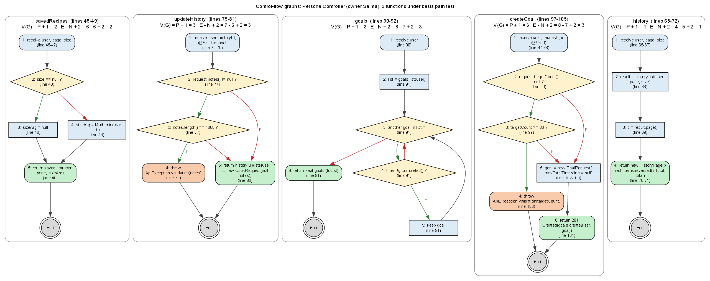

# PersonalController - STQA report (Saima)

Source under test: [`backend/src/main/java/com/bachelorchef/controller/PersonalController.java`](../../../backend/src/main/java/com/bachelorchef/controller/PersonalController.java)  
Test code: [`backend/src/test/java/com/bachelorchef/stqa/saima`](../../../backend/src/test/java/com/bachelorchef/stqa/saima)  
Executed: (not run) with JUnit 5 + Mockito + MockMvc (standalone controller, real validation and error handler, mocked services).

## Execution summary

| Technique | Cases | Pass | Fail | Not run |
|---|---|---|---|---|
| BVA | 10 | 7 | 3 | 0 |
| ECT | 8 | 2 | 6 | 0 |
| Basis path | 12 | 7 | 5 | 0 |
| Total | 30 | 16 | 14 | 0 |

Every failing case confirms a seeded defect (see the Defect column); no test failed for any other reason.

## Test cases

| TC ID | Action/Feature | Test Data | Expected Result | Actual Result | Status | xUnit Method |
|---|---|---|---|---|---|---|
| TC-01 | Create goal: target count (BVA) | targetCount = 0 | 400 'Must be between 1 and 30.' | As expected. JUnit: Passed (58 ms). | Pass | PersonalBvaTest.goalTarget(TC-01, 0, false) |
| TC-02 | Create goal: target count (BVA) | targetCount = 1 (min) | 201 Created | As expected. JUnit: Passed (34 ms). | Pass | PersonalBvaTest.goalTarget(TC-02, 1, true) |
| TC-03 | Create goal: target count (BVA) | targetCount = 29 | 201 Created | As expected. JUnit: Passed (29 ms). | Pass | PersonalBvaTest.goalTarget(TC-03, 29, true) |
| TC-04 | Create goal: target count (BVA) | targetCount = 30 (max) | 201 Created: 30 is the maximum allowed | Defect BUG-28: Status expected:<201> but was:<400>. JUnit: Failed (27 ms). | Fail | PersonalBvaTest.goalTarget(TC-04, 30, true) |
| TC-05 | Create goal: target count (BVA) | targetCount = 31 | 400 'Must be between 1 and 30.' | As expected. JUnit: Passed (28 ms). | Pass | PersonalBvaTest.goalTarget(TC-05, 31, false) |
| TC-06 | Edit cook: notes length (BVA) | notes = 999 chars | 200; notes saved | As expected. JUnit: Passed (29 ms). | Pass | PersonalBvaTest.notesLength(TC-06, 999, true) |
| TC-07 | Edit cook: notes length (BVA) | notes = 1000 chars (max) | 200; notes saved | Defect BUG-26: Status expected:<200> but was:<400>. JUnit: Failed (31 ms). | Fail | PersonalBvaTest.notesLength(TC-07, 1000, true) |
| TC-08 | Edit cook: notes length (BVA) | notes = 1001 chars | 400 fieldErrors.notes | As expected. JUnit: Passed (33 ms). | Pass | PersonalBvaTest.notesLength(TC-08, 1001, false) |
| TC-09 | Cookbook: page size (BVA) | size = 12 | Service asked for size 12 | Defect BUG-22: service was called with savedRecipeService.list( AuthUser[id=6, email=user2@user.com, role=USER], null, 10 );. JUnit: Failed (20 ms). | Fail | PersonalBvaTest.cookbookPageSize(TC-09, 12) |
| TC-10 | Cookbook: page size (BVA) | size = 10 | Service asked for size 10 | As expected. JUnit: Passed (19 ms). | Pass | PersonalBvaTest.cookbookPageSize(TC-10, 10) |
| TC-11 | Save recipe to cookbook (ECT) | recipe 1 | 204 No Content | Defect BUG-21: Status expected:<204> but was:<201>. JUnit: Failed (18 ms). | Fail | PersonalEctTest.saveRecipe |
| TC-12 | Remove recipe from cookbook (ECT) | recipe 1 | 204 No Content | As expected. JUnit: Passed (19 ms). | Pass | PersonalEctTest.unsaveRecipe |
| TC-13 | Save unknown recipe (ECT) | recipe 999 (not found) | 404, code NOT_FOUND | As expected. JUnit: Passed (24 ms). | Pass | PersonalEctTest.saveUnknownRecipe |
| TC-14 | Edit goal: count mode (ECT) | countMode = COOK_EVENTS | Service gets countMode COOK_EVENTS | Defect BUG-30: service was called with goalService.update( AuthUser[id=6, email=user2@user.com, role=USER], 4L, GoalRequest[title=null, targetCount=null, month=null, countMode=null, tagId=null, maxTotalTimeMins=null] );. JUnit: Failed (23 ms). | Fail | PersonalEctTest.changeCountMode |
| TC-15 | Create goal: time limit (ECT) | maxTotalTimeMins = 15 | 201; service gets maxTotalTimeMins 15 | Defect BUG-29: service was called with goalService.create( AuthUser[id=6, email=user2@user.com, role=USER], GoalRequest[title=Quick dinners, targetCount=5, month=2026-10, countMode=null, tagId=null, maxTotalTimeMins=null] );. JUnit: Failed (26 ms). | Fail | PersonalEctTest.goalWithTimeLimit |
| TC-16 | Goals list: completed goal (ECT) | goals: 1/1 (done), 2/5 | Both goals listed; first is completed | Defect BUG-27: JSON path "$.length()" expected:<2> but was:<1>. JUnit: Failed (25 ms). | Fail | PersonalEctTest.completedGoalListed |
| TC-17 | Edit cook: new date (ECT) | cookedOn = 2026-10-12T12:00:00Z | Service gets the new date | Defect BUG-25: service was called with cookingHistoryService.update( AuthUser[id=6, email=user2@user.com, role=USER], 3L, CookRequest[cookedOn=null, notes=Lunch] );. JUnit: Failed (30 ms). | Fail | PersonalEctTest.changeCookDate |
| TC-18 | Cook history: same recipe twice (ECT) | 2 cooks of recipe 30 | totalCookEvents 2, distinctRecipes 1 | Defect BUG-23: JSON path "$.distinctRecipes" expected:<1> but was:<2>. JUnit: Failed (28 ms). | Fail | PersonalEctTest.repeatRecipeTotals |
| TC-19 | savedRecipes P1 (basis path) | size = null | Service gets size null | As expected. JUnit: Passed (18 ms). | Pass | PersonalBasisPathTest.savedRecipesP1 |
| TC-20 | savedRecipes P2 (basis path) | size = 50 | Service gets size 50 | Defect BUG-22: service was called with savedRecipeService.list( AuthUser[id=6, email=user2@user.com, role=USER], 0, 10 );. JUnit: Failed (16 ms). | Fail | PersonalBasisPathTest.savedRecipesP2 |
| TC-21 | updateHistory P1 (basis path) | notes = null, cookedOn = null | Request sent unchanged | As expected. JUnit: Passed (351 ms). | Pass | PersonalBasisPathTest.updateHistoryP1 |
| TC-22 | updateHistory P2 (basis path) | notes = 1200 chars | ApiException 400; nothing saved | As expected. JUnit: Passed (18 ms). | Pass | PersonalBasisPathTest.updateHistoryP2 |
| TC-23 | updateHistory P3 (basis path) | notes = 'Tasty', new date | Request (date + notes) sent unchanged | Defect BUG-25: service was called with cookingHistoryService.update( AuthUser[id=6, email=user2@user.com, role=USER], 3L, CookRequest[cookedOn=null, notes=Tasty] );. JUnit: Failed (25 ms). | Fail | PersonalBasisPathTest.updateHistoryP3 |
| TC-24 | goals P1 (basis path) | no goals | Empty list | As expected. JUnit: Passed (20 ms). | Pass | PersonalBasisPathTest.goalsP1 |
| TC-25 | goals P2 (basis path) | 1 goal in progress | Goal listed | As expected. JUnit: Passed (15 ms). | Pass | PersonalBasisPathTest.goalsP2 |
| TC-26 | goals P3 (basis path) | 1 completed goal | Goal listed as completed | Defect BUG-27: expected: <[GoalView[id=1, title=Cook dinners, targetCount=1, month=2026-10, countMode=UNIQUE_RECIPES, tag=null, maxTotalTimeMins=null, progress=1, percent=100, completed=true, completedAt=2026-10-12T10:00:00Z, createdAt=2026-10-0.... JUnit: Failed (39 ms). | Fail | PersonalBasisPathTest.goalsP3 |
| TC-27 | createGoal P1 (basis path) | targetCount = null | Request sent to the service unchanged | As expected. JUnit: Passed (18 ms). | Pass | PersonalBasisPathTest.createGoalP1 |
| TC-28 | createGoal P2 (basis path) | targetCount = 45 | ApiException 400; nothing saved | As expected. JUnit: Passed (15 ms). | Pass | PersonalBasisPathTest.createGoalP2 |
| TC-29 | createGoal P3 (basis path) | targetCount = 5, limit 20 min | Request saved unchanged; 201 Created | Defect BUG-29: service was called with goalService.create( AuthUser[id=6, email=user2@user.com, role=USER], GoalRequest[title=Quick dinners, targetCount=5, month=2026-10, countMode=COOK_EVENTS, tagId=null, maxTotalTimeMins=null] );. JUnit: Failed (21 ms). | Fail | PersonalBasisPathTest.createGoalP3 |
| TC-30 | history P1 (basis path) | 2 cooks of 1 recipe, newest first | Service page returned unchanged | Defect BUG-23, BUG-24: expected: <HistoryPage[page=PageResponse[items=[HistoryView[id=2, recipe=HistoryRecipe[id=30, title=Egg Fried Rice, imageUrl=null, totalTimeMins=15, available=true], cookedOn=2026-10-12T12:00:00Z, notes=null, createdAt=2026-10-12T.... JUnit: Failed (41 ms). | Fail | PersonalBasisPathTest.historyP1 |

## Boundary value analysis

| Input | Function | Constraint | Min-1 | Min | Min+1 | Nominal | Max-1 | Max | Max+1 | Expected | Cases |
|---|---|---|---|---|---|---|---|---|---|---|---|
| Goal target count | createGoal (POST /users/me/goals) | 1..30 (AGENTS.md 5; GoalService) | 0 | 1 | 2 | 5 | 29 | 30 | 31 | 0 and 31 rejected (400); 1..30 created (201) | TC-01..05, TC-28 |
| Cook notes length | updateHistory (PATCH /users/me/cooked-history/{id}) | <= 1000 chars (CookRequest @Size(max = 1000)) | - | 0 | 1 | 50 | 999 | 1000 | 1001 | 1001 rejected (400); up to 1000 saved | TC-06..08, TC-22 |
| Cookbook page size | savedRecipes (GET /users/me/saved-recipes) | 1..100 (Pagination.MAX_SIZE) | 0 | 1 | 2 | 12 | 99 | 100 | 101 | Size passed unchanged (the web app asks for 12) | TC-09, TC-10, TC-20 |

## Equivalence classes

| Input | Class | Description | Valid/invalid | Representative | Expected | Cases |
|---|---|---|---|---|---|---|
| Save to cookbook | EC1 | Existing recipe | Valid | recipe 1 | 204 No Content | TC-11 |
| Remove from cookbook | EC2 | Saved recipe | Valid | recipe 1 | 204 No Content | TC-12 |
| Save to cookbook | EC3 | Unknown recipe | Invalid | recipe 999 | 404 NOT_FOUND | TC-13 |
| Goal count mode | EC4 | COOK_EVENTS | Valid | COOK_EVENTS | Mode changed | TC-14 |
| Goal count mode | EC5 | UNIQUE_RECIPES (default) | Valid | UNIQUE_RECIPES | Mode kept | TC-27 |
| Goal time limit | EC6 | Limit given | Valid | 15 minutes | Limit saved on the goal | TC-15, TC-29 |
| Goal time limit | EC7 | No limit | Valid | (none) | Goal without a limit | TC-27 |
| Goal state | EC8 | Completed goal | Valid | progress 1/1 | Listed as completed | TC-16, TC-26 |
| Goal state | EC9 | Goal in progress | Valid | progress 2/5 | Listed | TC-25 |
| Cook date edit | EC10 | New date given | Valid | 2026-10-12T12:00:00Z | Date changed | TC-17, TC-23 |
| Cook history | EC11 | Same recipe cooked twice | Valid | 2 cooks of recipe 30 | 2 cooks, 1 different recipe | TC-18, TC-30 |

## Basis path testing

V(G) is computed from the control-flow graph of the current source: decisions + 1, cross-checked with E - N + 2.

| Function | Lines | Decisions | V(G)=P+1 | E | N | E-N+2 | Paths | Pass | Fail |
|---|---|---|---|---|---|---|---|---|---|
| savedRecipes | 45-49 | 1 | 2 | 6 | 6 | 2 | 2 | 1 | 1 |
| updateHistory | 75-81 | 2 | 3 | 7 | 6 | 3 | 3 | 2 | 1 |
| goals | 90-92 | 2 | 3 | 8 | 7 | 3 | 3 | 2 | 1 |
| createGoal | 97-105 | 2 | 3 | 8 | 7 | 3 | 3 | 2 | 1 |
| history | 65-72 | 0 | 1 | 4 | 5 | 1 | 1 | 0 | 1 |

| Function | Path | Node sequence | Conditions | Test case | Result |
|---|---|---|---|---|---|
| savedRecipes | P1 | 1 -> 2 -> 3 -> 5 -> End | size == null: T | TC-19 | Pass |
| savedRecipes | P2 | 1 -> 2 -> 4 -> 5 -> End | size == null: F | TC-20 | Fail |
| updateHistory | P1 | 1 -> 2 -> 5 -> End | notes != null: F | TC-21 | Pass |
| updateHistory | P2 | 1 -> 2 -> 3 -> 4 -> End | notes != null: T; >= 1000: T | TC-22 | Pass |
| updateHistory | P3 | 1 -> 2 -> 3 -> 5 -> End | notes != null: T; >= 1000: F | TC-23 | Fail |
| goals | P1 | 1 -> 2 -> 3 -> 6 -> End | loop: 0 times | TC-24 | Pass |
| goals | P2 | 1 -> 2 -> 3 -> 4 -> 5 -> 3 -> 6 -> End | loop once; !completed: T | TC-25 | Pass |
| goals | P3 | 1 -> 2 -> 3 -> 4 -> 3 -> 6 -> End | loop once; !completed: F | TC-26 | Fail |
| createGoal | P1 | 1 -> 2 -> 5 -> 6 -> End | targetCount != null: F | TC-27 | Pass |
| createGoal | P2 | 1 -> 2 -> 3 -> 4 -> End | != null: T; >= 30: T | TC-28 | Pass |
| createGoal | P3 | 1 -> 2 -> 3 -> 5 -> 6 -> End | != null: T; >= 30: F | TC-29 | Fail |
| history | P1 | 1 -> 2 -> 3 -> 4 -> End | (no decision) | TC-30 | Fail |

## Defects confirmed

| Defect | Title | Severity | Confirmed by |
|---|---|---|---|
| BUG-21 | Saving a recipe returns 201 Created instead of 204 No Content | Low | TC-11 |
| BUG-22 | Cookbook page size is capped at 10 | Minor | TC-09, TC-20 |
| BUG-23 | "Different recipes" equals total cooks | Minor | TC-18, TC-30 |
| BUG-24 | Cooking history is oldest-first within a page | Minor | TC-30 |
| BUG-25 | Editing the date of a cook event is not saved | Minor | TC-17, TC-23 |
| BUG-26 | Notes of exactly 1000 characters are rejected | Minor | TC-07 |
| BUG-27 | Completed goals disappear from the goals list | Minor | TC-16, TC-26 |
| BUG-28 | Goal target of 30 is rejected | Minor | TC-04 |
| BUG-29 | "Only recipes up to N minutes" is ignored when creating a goal | Minor | TC-15, TC-29 |
| BUG-30 | Changing a goal's count mode is ignored | Minor | TC-14 |

## Files

- `Personal_TestCases.xlsx` - the 30 test cases in the team format (TC ID ... xUnit Method)
- `Personal_TestDesign.xlsx` - summary, BVA table, ECT table, full test-case sheet, defects
- `Personal_BasisPath.xlsx` + `Personal_FlowGraphs.png` - V(G), independent paths, node legend, flow graphs
- `evidence/` - JUnit XML of the run these files were generated from
